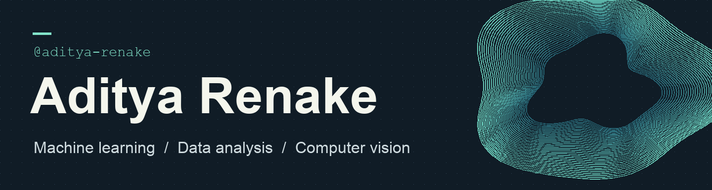

I build web apps and experiment with what a camera can do. My projects use camera input in different ways, from scanning event passes at the gate to turning hand movements into mouse controls.

## Featured build · Eventra

**From registration to check-in with a single QR pass.** An attendee registers and gets a signed digital pass. At the venue, staff scan it with a browser camera and verify it against the registration record.

`React` · `Vite` · `Node.js` · `HMAC-SHA256`

© 2026 Aditya Vinod Renake. I am the sole author and copyright owner of Eventra.

[Try Eventra](https://eventra-2026.vercel.app) · [Explore the source](https://github.com/aditya-renake/Eventra)

## Computer vision and health

- [Virtual Mouse](https://github.com/aditya-renake/Virtual-Mouse) — Control the pointer with hand movements captured by a webcam.
- [Sandhi.ai](https://github.com/aditya-renake/sandhi.ai) — Explore movement analysis and patient assessments in an osteoarthritis screening prototype.
- [MediaPipe experiments](https://github.com/aditya-renake/mediapipe) — Try Python examples for hand tracking and facial landmarks.
- [OpenCV examples](https://github.com/aditya-renake/opencv) — Explore image rotation, cropping, resizing, and bitwise operations.

## Apps and hackathon repositories

- [QR Code Scanner](https://github.com/aditya-renake/qr-code-scanner)
- [ZeroDatabase](https://github.com/aditya-renake/zerodatabase)
- [HH Goa 2026](https://github.com/aditya-renake/hh-goa-2026)
- [NextGen Final](https://github.com/aditya-renake/nextgenfinal)
- [SIH 2026 Backend](https://github.com/aditya-renake/sih-2026-backend)
- [Hacktoberfest Final](https://github.com/aditya-renake/Hacktoberfestfinal)
- [Napkin Hacktoberfest](https://github.com/aditya-renake/NAPKINHACKTOBERFEST)

## Data analysis

- [NumPy](https://github.com/aditya-renake/numpy)
- [pandas](https://github.com/aditya-renake/pandas)
- [SQL](https://github.com/aditya-renake/SQL)

## Algorithms and coursework

- [Data Structures and Algorithms](https://github.com/aditya-renake/DSA)
- [DSL Prep](https://github.com/aditya-renake/DSL-Prep)
- [DSL Lab](https://github.com/aditya-renake/dsllab)
- [C++](https://github.com/aditya-renake/cpp)
- [LeetCode Solutions](https://github.com/aditya-renake/leetcode-solutions)
- [LeetCode Interview Questions by Company](https://github.com/aditya-renake/leetcode-companywise-interview-questions)
